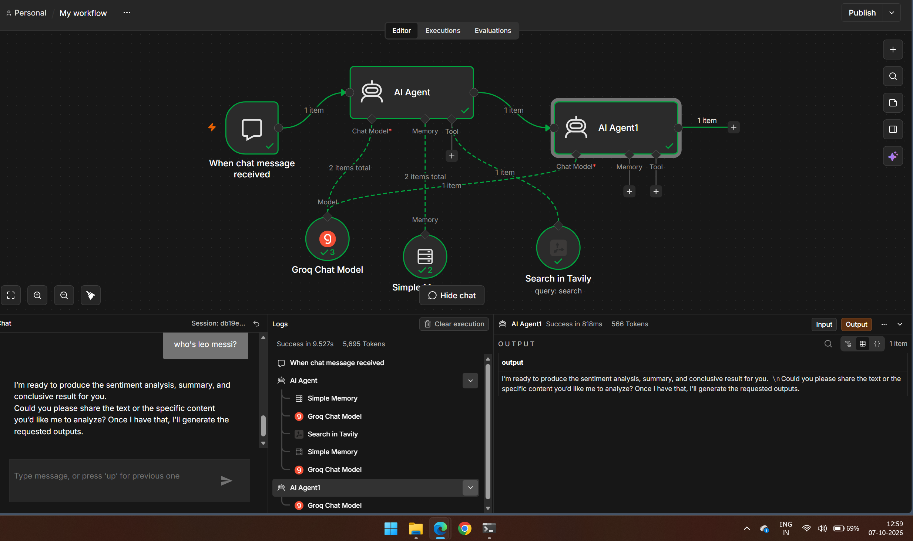
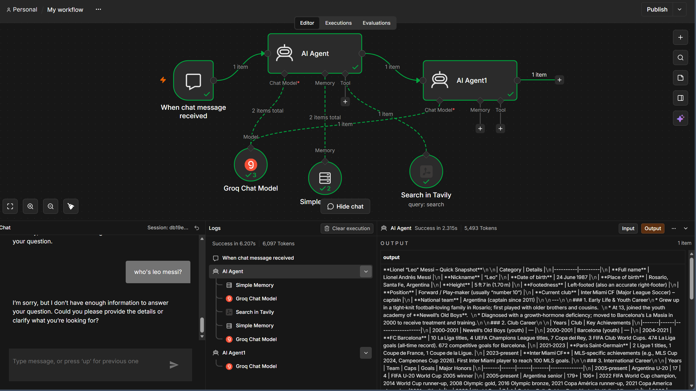
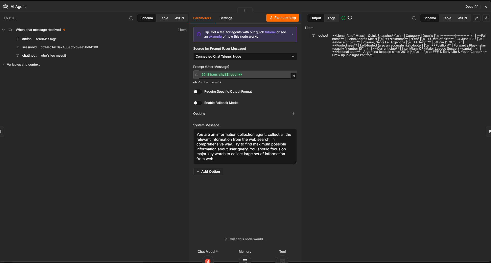
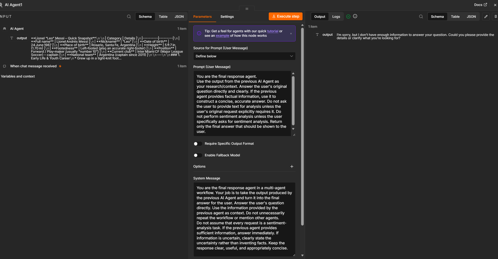

# Multi-Agent AI Research and Response Workflow

An AI-powered, multi-agent workflow built using **n8n, Groq, and Tavily Search** to collect web-based information, process research context, and generate user-facing responses through coordinated AI agents.

## 1. Project Overview

This project demonstrates how multiple AI agents can collaborate within an automated workflow to handle information-seeking queries.

Instead of relying on a single agent for the entire task, the workflow separates information collection from final response generation. The first agent focuses on gathering relevant information from the web, while the second agent uses the collected context to formulate a clear and relevant answer.

The workflow combines large language models, web search, prompt engineering, memory, and workflow orchestration to demonstrate a modular approach to AI-assisted research.

## 2. Project Objectives

- Build a multi-agent AI workflow using n8n.
- Separate web research from final response generation.
- Integrate Groq Chat Model for language-model inference.
- Use Tavily Search to retrieve relevant web information.
- Design prompts that define the responsibilities of individual agents.
- Pass research output between agents to support contextual responses.
- Explore the role of memory and orchestration in conversational AI systems.

## 3. Technologies Used

| Technology | Purpose |
|---|---|
| **n8n** | Workflow automation, orchestration, and execution |
| **Groq Chat Model** | LLM inference for the AI agents |
| **Tavily Search** | Web search and information retrieval |
| **AI Agent nodes** | Execute research and response-generation tasks |
| **Simple Memory** | Maintains conversational context where configured |

## 4. System Architecture

The workflow contains a chat trigger, two AI Agent nodes, a Groq Chat Model, a Tavily Search tool, and Simple Memory.

### Workflow Sequence

**User Query → Chat Trigger → Agent 1: Research and Information Collection → Agent 2: Final Response Generation → User**

The Groq model is connected to the agents to support language understanding and generation. Tavily is available as a search tool for the research agent, while Simple Memory provides conversational context.

The agents have separate responsibilities, allowing the workflow to divide a larger task into smaller, more manageable stages.

## 5. Agent 1 — Research and Information Collection Agent

### Purpose

Agent 1 acts as the **research agent**. Its responsibility is to understand the user's query, identify relevant search terms, and gather useful information from the web using the available Tavily Search tool.

### System Prompt

```text
You are an information collection agent. Collect all the
relevant information from the web in a comprehensive way.

Try to find maximum possible information about the user query.
You should focus on major keywords to collect a large set
of information from the web.
```

### Responsibilities

1. **Understand the query:** Interpret the user's question and identify its main subject and relevant keywords.
2. **Plan information retrieval:** Determine what information is needed to address the request.
3. **Search the web:** Use Tavily Search to retrieve relevant web information.
4. **Collect research context:** Gather information that may help answer the original question.
5. **Pass information downstream:** Provide the collected output to Agent 2 for final response generation.

### Expected Output

Agent 1 produces a research-oriented response containing information relevant to the user's query. The output serves as context for the next agent rather than necessarily being the final answer shown to the user.

### Why Agent 1 Is Needed

Separating research from final response generation gives the workflow a dedicated stage for gathering external information. This can help the downstream agent produce more informative answers, particularly when the query requires current or specific facts.

The quality of the result depends on the search results, query interpretation, and the information returned by the research agent.

## 6. Agent 2 — Final Response Generation Agent

### Purpose

Agent 2 acts as the **final response agent**. It receives the output from Agent 1 and uses that information as research context to construct the answer presented to the user.

### User Message Prompt

```text
You are the final response agent.

Use the output from the previous AI Agent as your
research/context. Answer the user's original question
directly and clearly.

If the previous agent provides factual information, use it
to construct a concise, accurate answer.

Do not ask the user to provide text for analysis unless
the user's original request explicitly requires it.

Do not perform sentiment analysis unless the user
specifically asks for sentiment analysis.

Return only the final answer that should be shown to the user.
```

### System Message

```text
You are the final response agent in a multi-agent workflow.
Your job is to take the output produced by the previous AI
Agent and turn it into the final answer for the user.

Answer the user's question directly. Use the information
provided by the previous agent as context.

Do not unnecessarily repeat the workflow or mention other
agents. Do not assume that every request is a sentiment-analysis
task.

If the previous agent provides sufficient information,
answer immediately. If information is uncertain, clearly
state the uncertainty rather than inventing facts.

Keep the response clear, useful, and appropriately concise.
```

### Responsibilities

1. **Receive upstream context:** Use the output produced by Agent 1 as research material.
2. **Interpret the original request:** Focus on what the user actually asked.
3. **Synthesize information:** Organize relevant details into a coherent answer.
4. **Generate the final response:** Produce a concise and understandable response for the user.
5. **Avoid unsupported claims:** Acknowledge uncertainty when the available information is insufficient.

### Expected Output

Agent 2 generates the final user-facing response using the upstream research context and the original question, where that information is available to the node.

### Why Agent 2 Is Needed

Research output can be lengthy, fragmented, or poorly structured for direct presentation. A separate response-generation agent provides a dedicated stage for synthesizing that information and aligning the answer with the user's actual request.

## 7. Role of Groq Chat Model

The Groq Chat Model supplies the language-model capabilities used by the AI Agent nodes.

Its role includes:
- Interpreting natural-language instructions.
- Supporting query understanding and reasoning.
- Processing research context.
- Generating natural-language responses.

Groq provides the model-inference capability; n8n coordinates the workflow, and Tavily provides the web search capability.

## 8. Role of Tavily Search

Tavily is integrated as a search tool to help the research agent retrieve information from the web.

Its role includes:
- Supporting searches based on relevant query terms.
- Retrieving information related to the user's question.
- Providing external research material to support the agent's response.

The usefulness and accuracy of the final answer depend partly on the relevance and quality of the retrieved information. Search results should not automatically be treated as verified facts.

## 9. Role of Simple Memory

Simple Memory is included in the workflow to support conversational context.

Depending on its configuration and how it is connected to each agent, memory can help retain relevant information across interactions within a session.

Memory does not replace web search or factual verification. Its purpose is to support continuity rather than independently retrieve new information.

## 10. Example Workflow

**Example user query:**

"Who is Lionel Messi, and what are his major career achievements?"

### Step 1 — User Input

The user submits the question through the n8n chat interface.

### Step 2 — Agent 1: Research

The research agent interprets the question, uses Tavily Search when appropriate, and collects relevant information about Messi's background and career achievements.

### Step 3 — Context Transfer

The research agent's output is passed to Agent 2 as contextual information.

### Step 4 — Agent 2: Final Response

The final response agent organizes the collected information into a clear answer that addresses the original question.

### Step 5 — User Output

The generated answer is displayed in the chat interface.

This is an illustrative example of the intended workflow, not a claim that every execution will follow this exact path or always produce a correct answer.

## 11. Prompt Engineering Approach

The workflow uses different prompts to establish distinct responsibilities for the two agents.

- **Agent 1 prompt:** Emphasizes comprehensive web-based information collection.
- **Agent 2 prompt:** Emphasizes answering the original question, using upstream context, avoiding unnecessary clarification, and not inventing facts.

This separation demonstrates task decomposition: the research and synthesis stages are handled by different agents with different instructions.

## 12. Screenshots and Documentation

### Workflow Overview



Shows the chat trigger, both AI Agent nodes, Groq Chat Model, Tavily Search, and Simple Memory connections.

### Agent Output Demonstration



Documents an example execution and the responses displayed in the chat interface.

### Agent 1 Prompt



Documents the research agent's information-collection instructions.

### Agent 2 Prompt



Documents the final response agent's prompt configuration.

## 13. Key Learnings

- Designing multi-agent workflows using n8n.
- Separating information retrieval from response generation.
- Integrating LLM inference with external search tools.
- Using prompt engineering to define agent responsibilities.
- Passing contextual output between workflow stages.
- Understanding memory, orchestration, and tool integration.
- Recognizing the importance of validating retrieved information and testing end-to-end behaviour.

## 14. Limitations and Future Improvements

### Current Limitations

- Search results may be incomplete, outdated, or irrelevant.
- The research agent may collect information that does not fully address the user's question.
- The final response depends on the quality of the upstream context.
- Memory behaviour depends on the configured session and connection settings.
- Multi-agent execution can introduce additional latency and token usage.
- The workflow requires further testing to establish reliability across different query types.

### Future Improvements

- Export the n8n workflow as a JSON file for reproducibility.
- Improve query planning and search-term generation.
- Add source attribution and factual verification.
- Introduce error handling and fallback behaviour.
- Evaluate response quality using a structured test set.
- Improve the handoff so Agent 2 always receives both the original question and Agent 1's research output.
- Test general knowledge, current-events, summarization, and explicitly requested sentiment-analysis queries separately.

## 15. Project Status

This repository documents the multi-agent workflow through screenshots and prompt descriptions. An exported n8n workflow JSON file can be added to enable others to import and reproduce the configuration.

**Project Focus:** Multi-Agent AI | Workflow Automation | Prompt Engineering | LLM Integration | Web Search | AI Orchestration
